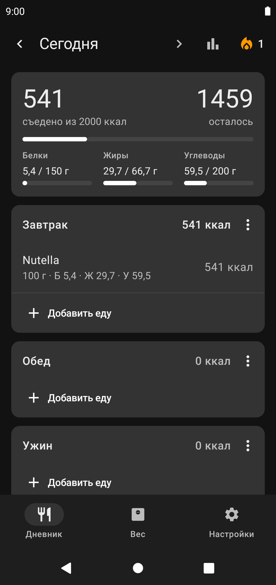
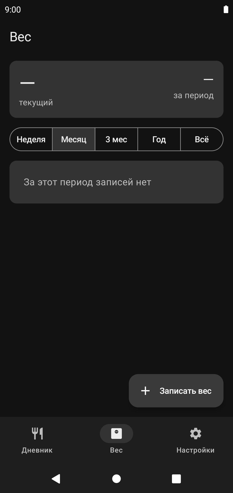
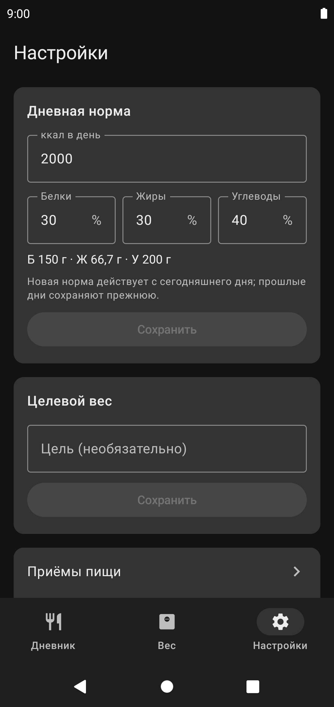

<div align="center">


# OpenFat

Простой дневник калорий, БЖУ и веса для Android.<br>
Без аккаунтов, рекламы и облака: все данные хранятся только на телефоне.

[](https://github.com/Sterrist/OpenFat/releases/latest)
[](#установка)
[](LICENSE)

[**Скачать APK**](https://github.com/Sterrist/OpenFat/releases/latest) ·
[Возможности](#возможности) ·
[Установка](#установка) ·
[Сборка](#сборка) ·
[Устройство проекта](#устройство-проекта) ·
[Приватность](#приватность) ·
[Источники данных](#источники-данных)

&nbsp;
&nbsp;


</div>

Интерфейс на русском, тёмная тема Material 3.

## Возможности

### Дневник питания
- Сводка за день: сколько съедено, сколько осталось до нормы, белки, жиры и углеводы.
- Приёмы пищи: по умолчанию «Завтрак», «Обед» и «Ужин». Их можно переименовывать, удалять, менять местами и добавлять новые, постоянные или на один день.
- Рядом с каждым приёмом видна сумма его калорий.
- Перекусы — отдельный блок, у каждого перекуса своё время.
- Любой день можно открыть и отредактировать: листать дни или выбрать дату в календаре.
- Запись можно изменить (количество, единица, перенос в другой приём) или удалить свайпом. Удаление можно отменить.
- История калорий за неделю и месяц.
- Серия дней с огоньком: сколько дней подряд вы записываете еду. Если вы вели учёт до OpenFat, эти дни можно добавить вручную.

### Добавление еды
- Один поиск сразу по недавним блюдам, своему справочнику, YAZIO и [Open Food Facts](https://world.openfoodfacts.org).
- Сканер штрихкодов. Ему не нужно разрешение на камеру, он работает через Google Code Scanner. Штрихкод ищется сначала в своём справочнике, потом в YAZIO, потом в Open Food Facts. Если продукт не найден, откроется форма нового продукта с уже подставленным штрихкодом.
- Количество в граммах, порциях или штуках. Если у продукта известен вес штуки или порции, они выбираются по умолчанию.
- Быстрый ввод: название и калории, Б/Ж/У по желанию.
- Найденные продукты сохраняются в свой справочник.
- Запись хранит КБЖУ на момент добавления, поэтому правка продукта не меняет прошлые дни.

### Вес
- Одно взвешивание в день, к нему можно добавить заметку.
- График за неделю, месяц, 3 месяца, год или всё время. Тренд строится как среднее за 7 дней, целевой вес показан пунктиром.
- Изменение за период, минимум, максимум и сколько осталось до цели.

### Настройки
- Дневная норма калорий и доли Б/Ж/У в процентах. Новая норма действует с текущего дня, у прошлых дней остаётся прежняя.
- Целевой вес.
- Вход в YAZIO, по желанию.
- Экспорт резервной копии в JSON, дневника и веса — в CSV (подходит для Excel).
- Импорт из JSON: можно слить данные с текущими или заменить всё. Перед применением показывается сводка.

## Установка

Нужен телефон с **Android 10** или новее и сервисами Google Play (они нужны сканеру штрихкодов).

1. Откройте на телефоне страницу [последнего релиза](https://github.com/Sterrist/OpenFat/releases/latest).
2. В разделе **Assets** скачайте файл `OpenFat-<версия>.apk`.
3. Откройте скачанный файл. Если Android спросит, разрешите браузеру или файловому менеджеру установку из неизвестных источников.
4. Нажмите «Установить».

Обновление ставится так же, поверх старой версии: данные сохраняются. Перед обновлением всё же стоит сделать резервную копию в настройках.

Если Play Защита предупреждает о неизвестном приложении, это нормально для приложений не из Google Play: нажмите «Всё равно установить».

Установка с компьютера (нужна отладка по USB):

```bash
adb install -r OpenFat-<версия>.apk
```

## Сборка

Понадобятся Android SDK Platform 37 и JDK 17 или новее. Подойдёт JDK, встроенный в Android Studio.

```bash
git clone https://github.com/Sterrist/OpenFat.git
cd OpenFat
./gradlew assembleDebug
adb install -r app/build/outputs/apk/debug/app-debug.apk
```

Можно и просто открыть проект в Android Studio и нажать Run. Если собираете без Android Studio, создайте `local.properties` с путём к SDK:

```properties
sdk.dir=/путь/к/Android/Sdk
```

Тесты и проверка lint:

```bash
./gradlew testDebugUnitTest lintDebug
```

### Release-сборка

Release включает R8 и сжатие ресурсов. Ключ подписи в репозиторий не входит, его путь и пароли берутся из `~/.gradle/gradle.properties`:

```properties
openfat.keystore=/путь/к/openfat-release.jks
openfat.keystore.password=...
openfat.key.alias=openfat
openfat.key.password=...
```

Вместо этого можно задать переменные окружения `OPENFAT_KEYSTORE`, `OPENFAT_KEYSTORE_PASSWORD`, `OPENFAT_KEY_ALIAS` и `OPENFAT_KEY_PASSWORD`. Затем:

```bash
./gradlew assembleRelease
```

Готовый APK: `app/build/outputs/apk/release/app-release.apk`. Без ключа получится неподписанный `app-release-unsigned.apk`, его нельзя установить.

## Устройство проекта

Один модуль на Kotlin. Внутри Jetpack Compose (Material 3), Room, ViewModel + StateFlow и Navigation Compose. Зависимости собираются вручную в `AppContainer`, без DI-фреймворка.

```
app/src/main/java/dev/sterrist/openfat/
├── OpenFatApp.kt     Application и AppContainer
├── MainActivity.kt
├── domain/           расчёт КБЖУ, нормы, серии, тренда веса
├── data/
│   ├── db/           Room: сущности, DAO, база
│   ├── repo/         репозитории: дневник, продукты, вес, настройки
│   ├── remote/       источники продуктов: YAZIO, Open Food Facts
│   └── backup/       экспорт, импорт и слияние данных
└── ui/               экраны: дневник, добавление еды, продукты, вес, история, настройки
```

| Компонент | Версия |
|---|---|
| Android Gradle Plugin | 9.4.1 |
| Gradle | 9.8.1 |
| Kotlin | 2.4.21 |
| Compose BOM | 2026.09.00 |
| Room | 2.8.5 |

Схема базы экспортируется в `app/schemas/`. Если она меняется, нужно поднять версию базы и добавить миграцию.

Новый источник продуктов подключается так: реализуйте интерфейс `FoodSource` (`data/remote/FoodSource.kt`) и зарегистрируйте его в `AppContainer`.

## Приватность

- Данные лежат в локальной базе SQLite в приватной папке приложения.
- Единственное разрешение — интернет, он нужен для поиска продуктов. В сеть уходят только поисковые запросы и штрихкоды.
- Токены YAZIO хранятся отдельно и не попадают ни в экспорт, ни в облачный бэкап Android. Пароль не сохраняется. От почты сохраняется только замаскированный вид (`exa****@mail.ru`).
- Файл импорта считается недоверенным: некорректные записи отбрасываются и попадают в сводку.

## Источники данных

- **[Open Food Facts](https://world.openfoodfacts.org)** — открытая база продуктов под лицензией [ODbL](https://opendatacommons.org/licenses/odbl/). Работает без регистрации.
- **YAZIO** — нужен ваш аккаунт YAZIO. Приложение использует **неофициальный** API, снятый с официального Android-клиента: его могут изменить или закрыть в любой момент. Используйте на свой страх и риск. OpenFat никак не связан с YAZIO.

## Ограничения

- Android 10 или новее.
- Только русский язык.
- Нет рецептов из нескольких ингредиентов и напоминаний.
- Полнота данных Open Food Facts зависит от сообщества. Если КБЖУ у продукта неполное, приложение предложит его дополнить.

## Лицензия

[MIT](LICENSE) © 2026 Sterrist. Данные Open Food Facts распространяются под лицензией ODbL.
